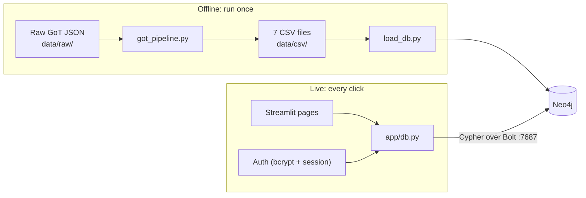

# Architecture

ENCORE has two halves:

- An **offline** half builds the database once.
- A **live** half answers questions every time someone clicks.



## Why it's split this way

- **The offline work is slow and only needs doing once.** Reading 4,165 scenes and every script line takes seconds, so we do it once and store the results.
- **CSVs are the checkpoint between the halves.** They can be opened in a spreadsheet, the tests check them, and they're committed to git, so anyone can load the database without the raw dataset.
- **`app/db.py` is the only gateway to Neo4j.** Pages and auth code call functions such as `db.follow(me, them)` and never write Cypher. A schema change touches one file, and teammates don't edit each other's files.

## Repository layout

```
crossed-paths/
├── app/
│   └── db.py                 # every Cypher query; one function per use case
├── pipeline/
│   ├── got_pipeline.py       # raw JSON → data/csv/*.csv
│   ├── synthetic.py          # generated users + follows (to reach 1,000+ nodes)
│   └── load_db.py            # data/csv/*.csv → Neo4j (re-runnable)
├── tests/
│   ├── test_pipeline.py      # checks on the CSV output (no DB needed)
│   └── test_db.py            # checks on db.py against a live Neo4j
├── scripts/fetch_data.sh     # downloads the raw dataset into data/raw/
├── data/
│   ├── csv/                  # pipeline output (committed)
│   └── raw/                  # downloaded dataset (git-ignored)
├── docs/                     # this documentation
├── docker-compose.yml        # local Neo4j 5
├── pyproject.toml, uv.lock   # Python packages (managed by uv)
└── .env.example              # connection settings template (.env is git-ignored)
```

## Design decisions

### Stack

| Decision | Why |
|---|---|
| **Neo4j** | Friend-of-friend, shortest path and neighborhood questions mean following connections, which a graph database does directly. The course also requires it. |
| **Python + Streamlit** | The team's strongest language. Streamlit makes a page from a Python script with almost no UI code. |
| **Docker for development, AuraDB for the shared demo** | Docker gives everyone a private database to wipe freely. Aura is reachable by the whole team. Only `.env` changes between them. |
| **uv** | `uv sync` gives everyone identical package versions (`uv.lock`) and a modern Python. |

### Data

| Decision | Why |
|---|---|
| **Lancaster's GoT dataset** | The only dataset found with all three signals: who is in each scene, where, and every spoken line. Approved by the professor. |
| **Every character is a user, plus 450 synthetic users** | The course needs ≥ 1,000 nodes; the dataset has 577 characters + 26 locations. Synthetic "smallfolk" users (`pipeline/synthetic.py`, fixed seed) fill the gap and live in separate `synthetic_*.csv` files so real and generated data are easy to tell apart. |
| **Only 10+-scene characters get automatic name aliases** | Extras like "Citadel Maester" or "Young Cersei" would otherwise hijack common words and main characters' names. |
| **CSV hand-off** | The pipeline can be inspected and tested without a database, and the database can be loaded without the pipeline. |
| **No character images** | Copyright. Avatars are initials only. |

### Database

| Decision | Why |
|---|---|
| **Signals separate from FOLLOWS** | Sensed signals only produce *suggestions*. Only users create follows, which keeps the privacy story honest. |
| **Seeded FOLLOWS** | Without starting follows, "mutual friends" would be empty. Strong ties become follows once. |
| **`CO_PRESENT` stored once per pair** | It's a symmetric fact. One edge, queried without direction, halves storage and can't disagree with itself. |
| **MERGE everywhere in the loader** | Rerunning gives the same graph (idempotent). |
| **`--reset` deletes only characters and locations** | Real sign-ups (`isCharacter: false`) survive rebuilds. |

### Teamwork

| Decision | Why |
|---|---|
| **All Cypher in `db.py`** | One place to change. Clean boundaries between teammates. |
| **UC-9 strictly two-hop; encounter signals only rank** | The course defines recommendations as exactly two follow hops. ENCORE's signals reorder those candidates; the full encounter-based list is a separate extra (`get_encounter_suggestions`). |
| **Real functions, not stubs** | The data was already loaded, so real queries took hours, and real data exposes edge cases early. |
| **One user-summary shape** `{username, name, house}` | One UI "user card" component works for every list. |
| **Logged-in user in `st.session_state["username"]`** | The single contract between the auth and UI code. |

Recommendation-specific decisions (weights, caps, cold start) are in [recommendations.md](recommendations.md).
