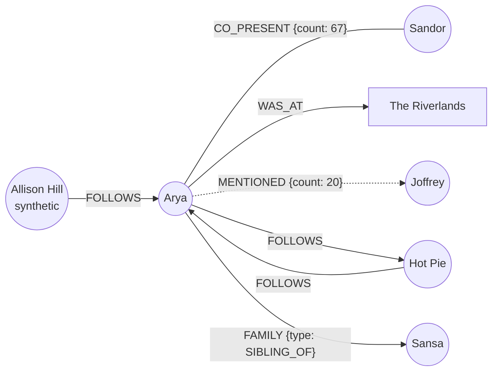
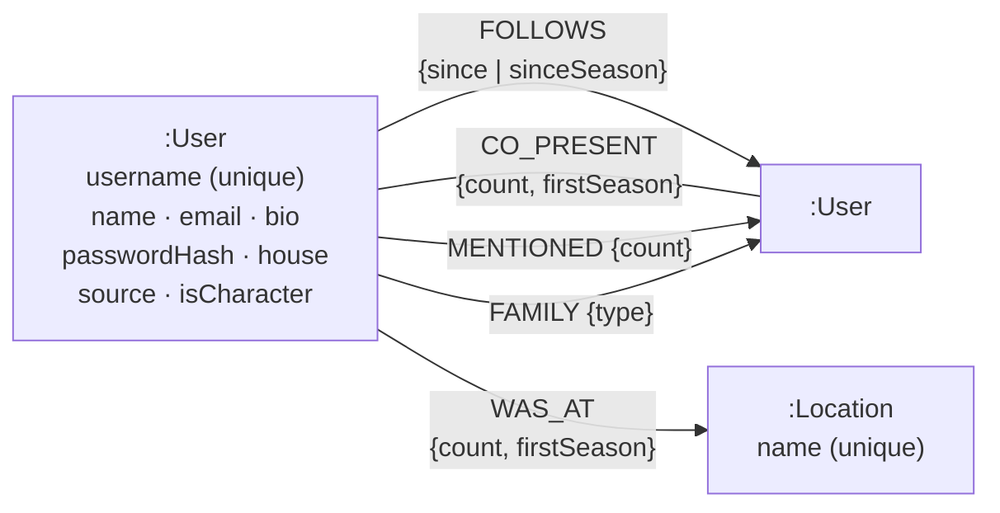

# Data model

ENCORE stores everything as a Neo4j property graph: **nodes** (dots) and **relationships** (lines), both with properties.



## Schema (for the report)



## Two layers

| Layer | Relationships | Used by |
|---|---|---|
| **Social**: what users choose | `FOLLOWS` | UC-5 to UC-9, UC-12, UC-13 |
| **Signals**: what a wearable would sense | `CO_PRESENT`, `WAS_AT`, `MENTIONED` | ranking in UC-9, encounter suggestions, network view |
| **Profile extra** | `FAMILY` | profiles |

Signals are never shown as friendships. They only feed suggestions.

## Nodes: 1,053 in total

### `:User` (1,027)

| Property | Type | Notes |
|---|---|---|
| `username` | string | **unique**, e.g. `jon_snow`; never changes after registration |
| `name` | string | display name |
| `email` | string | required at registration. Characters: `username@westeros.example`; synthetic users: `username@example.com` (both **generated**) |
| `bio` | string | optional; auto-generated for loaded users |
| `passwordHash` | string | bcrypt; never displayed |
| `house` | string | e.g. `Stark`; `''` if unknown or not a character |
| `sceneCount`, `topLocation` | int, string | characters only |
| `isCharacter` | bool | `true` for GoT characters |
| `source` | string | `'dataset'` (577 characters), `'synthetic'` (450 generated), `'app'` (registered in the app) |
| `createdAt` | datetime | |

### `:Location` (26)

| Property | Type | Notes |
|---|---|---|
| `name` | string | **unique**; regions such as `The North`, `The Crownlands`, `Braavos` |

Locations are **regions**, not castles: Winterfell is part of "The North".

## Relationships: 11,535 in total

| Type | Direction | Properties | Count | Origin |
|---|---|---|---|---|
| `FOLLOWS` | follower → followed | `sinceSeason` (seeded) or `since` datetime (synthetic / app) | 4,215 | 1,334 derived from scenes + 2,881 synthetic + app |
| `CO_PRESENT` | stored once per pair; **query without direction** `-[:CO_PRESENT]-` | `count`, `firstSeason` | 4,236 | dataset |
| `WAS_AT` | User → Location | `count`, `firstSeason` | 1,417 | 967 dataset + 450 synthetic home regions |
| `MENTIONED` | speaker → named user | `count` | 1,428 | dataset (name matching) |
| `FAMILY` | A → B | `type`: `CHILD_OF` / `SIBLING_OF` / `MARRIED_TO` | 239 | dataset |

`firstSeason` is the **first** season the pair or visit appears; `count` is the whole-show total.

## Constraints

Created by the loader before any data:

```cypher
CREATE CONSTRAINT user_username IF NOT EXISTS FOR (u:User) REQUIRE u.username IS UNIQUE;
CREATE CONSTRAINT location_name IF NOT EXISTS FOR (l:Location) REQUIRE l.name IS UNIQUE;
```

These make lookups by username fast, and they enforce UC-1's "no duplicate usernames": Neo4j rejects the second `CREATE`.

## Useful queries for Neo4j Browser

```cypher
// Schema overview
CALL db.schema.visualization();

// Size check (course minimum: 1,000 nodes, 5,000 relationships)
MATCH (n) WITH count(n) AS nodes MATCH ()-[r]->() RETURN nodes, count(r) AS relationships;

// Real vs synthetic users
MATCH (u:User) RETURN u.source, count(*);

// Someone's strongest scene partners
MATCH (:User {username: 'jon_snow'})-[r:CO_PRESENT]-(o) RETURN o.name, r.count ORDER BY r.count DESC LIMIT 10;
```
