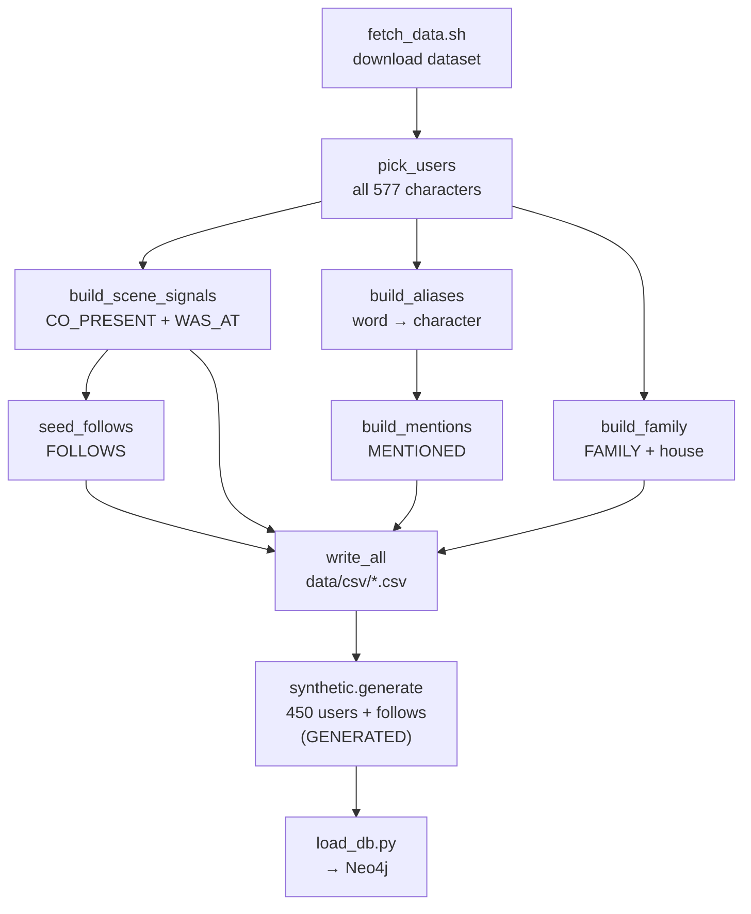

# Data pipeline

`pipeline/got_pipeline.py` turns the raw Game of Thrones JSON into CSVs and calls `pipeline/synthetic.py` to generate extra users. `pipeline/load_db.py` then loads everything into Neo4j.



## Commands

```bash
./scripts/fetch_data.sh                      # once; skipped if already downloaded
uv run python pipeline/got_pipeline.py       # optional args: <raw data dir> <output dir>
uv run pytest tests/test_pipeline.py         # check the output
uv run python pipeline/load_db.py --reset    # load into Neo4j
```

The output is **deterministic**: the same input always gives byte-identical CSVs, including the synthetic ones (fixed random seed, sorted inputs).

## Inputs (from `data/raw/game-of-thrones/data/`)

| File | Used for |
|---|---|
| `episodes.json` | 73 episodes → 4,165 scenes, each with `location` and `characters` |
| `script-bag-of-words.json` | every spoken line: speaker + the line's words **in alphabetical order** |
| `characters.json` | `houseName`, `parents`, `siblings`, `marriedEngaged` |

## Steps

**1. `pick_users`**: every character who appears in at least `MIN_SCENES` (1) scenes becomes a user: **577**. A character listed twice in one scene counts once. Usernames are the name lowercased, with non-alphanumerics as `_` (`Jaqen H'ghar` → `jaqen_h_ghar`). The pipeline stops if two names would produce the same username.

**2. `build_scene_signals`**: for each scene, take the users on screen. Every pair gets +1 shared scene, and every person gets +1 visit to the location. Each pair or visit also keeps the **earliest** season (`min`), regardless of file order.

**3. `build_aliases`**: because script words are shuffled, names can only be matched **one word at a time**. Only characters with `ALIAS_MIN_SCENES` (10) or more scenes get an automatic alias: the first word after stripping titles (Ser, Lord, Lady, King, Queen, Maester, The, …). Without that limit, extras would hijack words: "Citadel Maester" would capture every "Citadel", and "Young Cersei" would make "Cersei" ambiguous. The alias is dropped if it:
- belongs to 2+ characters (ambiguous),
- is 2 letters or shorter, or a title,
- appears in lowercase more than `COMMON_WORD_LIMIT` (20) times, meaning it's an ordinary word like "night" or "will".

Then `NICKNAMES` is added on top (Ned, Jon, Dany, Khaleesi, Sam, Littlefinger, Hound, Imp, Mountain, Worm, Kingslayer, Blackfish, Drogo, Reek, Pod, Joff, Baelish). Skipped on purpose: "Snow" (also Ramsay's surname before he was legitimized), shared surnames (Clegane, Bolton, Greyjoy), "Spider", "Pie".

**4. `build_mentions`**: for each line whose speaker is a user (any of the 577, matched ignoring case), every capitalized word that is an alias adds +1 to `speaker → target`. Self-mentions don't count.

**5. `build_family`**: from `characters.json`, keep parent, sibling and spouse links where both people are users (matched ignoring case). It also records each user's house (the first one if the dataset lists several).

**6. `seed_follows`**: starting follows between characters, so mutual connections and recommendations work on day one. **These follows are derived, not in the dataset.**

| Shared scenes | Result |
|---|---|
| ≥ `STRONG_TIE` (20) | follow each other |
| `WEAK_TIE` (5) – 19 | the one with fewer scene partners follows the one with more |
| < 5 | none |

**7. `write_all`**: writes the dataset-derived CSVs. Each user gets:
- an auto bio, e.g. "House Stark · 360 scenes · most often at The Riverlands",
- a **synthetic email** `username@westeros.example`, because the dataset has no emails. `.example` is a reserved domain that can never be real.

**8. `synthetic.generate`** (`pipeline/synthetic.py`): **all generated**, to reach the course's 1,000-node minimum.
- **450 users** with Faker names, emails `username@example.com`, bio "Smallfolk from &lt;region&gt;", and a random home region.
- Each follows **3–10 people**: 70% characters (picked in proportion to scene count, so main characters get more followers) and 30% other synthetic users.
- Fixed seed `42`, so the users and follows are the same on every run.

## Outputs (`data/csv/`, committed)

| File | Rows | Columns | Origin |
|---|---|---|---|
| `users.csv` | 577 | username, name, email, house, scene_count, top_location, bio | dataset (email and bio generated) |
| `locations.csv` | 26 | name | dataset |
| `co_present.csv` | 4,236 | user_a, user_b, count, first_season | dataset |
| `was_at.csv` | 967 | username, location, count, first_season | dataset |
| `mentioned.csv` | 1,428 | speaker, target, count | dataset (derived by name matching) |
| `family.csv` | 239 | user_a, user_b, type | dataset |
| `follows_seed.csv` | 1,334 | follower, followed, since_season | **derived** from shared scenes |
| `synthetic_users.csv` | 450 | username, name, email, bio, home_location | **synthetic** |
| `synthetic_follows.csv` | 2,881 | follower, followed | **synthetic** |

## Settings

| Setting | File | Default | Effect |
|---|---|---|---|
| `MIN_SCENES` | got_pipeline.py | 1 | character → user cutoff |
| `ALIAS_MIN_SCENES` | got_pipeline.py | 10 | who gets an automatic name alias |
| `STRONG_TIE` / `WEAK_TIE` | got_pipeline.py | 20 / 5 | seed follow thresholds |
| `COMMON_WORD_LIMIT` | got_pipeline.py | 20 | lowercase uses before an alias counts as a common word |
| `TITLES`, `NICKNAMES` | got_pipeline.py | — | alias rules |
| `N_USERS` | synthetic.py | 450 | number of synthetic users |
| `FOLLOWS_PER_USER` | synthetic.py | (3, 10) | follows per synthetic user |
| `SHARE_FOLLOWING_CHARACTERS` | synthetic.py | 0.7 | share of synthetic follows going to characters |
| `SEED` | synthetic.py | 42 | change to get a different (still reproducible) synthetic set |

After changing a setting: rerun the pipeline, run the tests, eyeball the printed top mentions, then reload with `--reset`.

## Loader (`load_db.py`)

1. Create the uniqueness constraints (`IF NOT EXISTS`).
2. With `--reset`: delete users with `source` `dataset` or `synthetic`, and all locations. **Users who registered in the app (`source: 'app'`) are kept.**
3. Load locations, then characters, then `CO_PRESENT`, `WAS_AT`, `MENTIONED`, `FAMILY`, seeded `FOLLOWS`, then synthetic users (plus their home `WAS_AT`) and synthetic `FOLLOWS`.
4. Each file is sent in batches of 500 rows with `UNWIND $rows AS r … MERGE …`, so reruns don't create duplicates.
5. Print node and relationship counts.

Representative loading query:

```cypher
UNWIND $rows AS r
MATCH (a:User {username: r.user_a}), (b:User {username: r.user_b})
MERGE (a)-[c:CO_PRESENT]->(b)
SET c.count = r.count, c.firstSeason = r.first_season
```

Every loaded user gets the bcrypt hash of `DEMO_PASSWORD` from `.env`. It's hashed once and shared, because bcrypt is deliberately slow.
