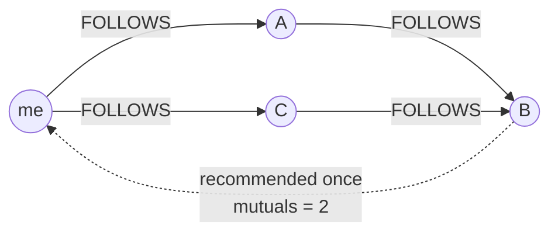

# How suggestions work

ENCORE has two kinds of suggestions:

| | **Friend recommendations (UC-9)** | **Encounter suggestions (ENCORE extra)** |
|---|---|---|
| Function | `get_recommendations` | `get_encounter_suggestions` |
| Who can appear | **only** people exactly two follow hops away | people you shared scenes with or mentioned |
| Based on | the follow graph (course rule) | the "wearable" signals (the project's idea) |
| Ranking | mutuals, then encounter signals | encounter signals |
| New user with no follows | empty list | home region regulars, then popular users |

## UC-9: friend recommendations



1. **Candidates:** everyone at the end of a `me → A → B` follow path, except me and people I already follow. The pattern `(me)-[:FOLLOWS]->(a)-[:FOLLOWS]->(c)` is fixed-length, so three-hop people can never sneak in.
2. **Once each:** results are grouped by candidate. `collect(DISTINCT a)` gathers every "A" in between, and its size is the **mutuals** count.
3. **Ranking**, which never changes who is included:

```
score = mutuals × 3  +  min(mentions, 5) × 2  +  min(sharedScenes, 20)
```

| Signal | Weight | Cap | Idea behind it |
|---|---|---|---|
| Mutual connections | 3 | — | **Triadic closure**: if your friends know someone, you probably do too. |
| Mentions (times I said their name) | 2 | 5 | Saying a name shows they matter to me. |
| Shared scenes | 1 | 20 | **Propinquity**: people who spend time near each other become friends. |

This is where ENCORE's idea fits inside the course rule. Among the two-hop candidates, someone you've actually *met* ranks higher.

Example for Arya:

```
Beric Dondarrion   followed by Sandor Clegane, Gendry, Jon Snow · shared 18 scenes · you mentioned them 3 times
Tyrion Lannister   followed by Sandor Clegane, Bran Stark, Sansa Stark +2 more · shared 11 scenes · you mentioned them 3 times
```

## Encounter suggestions ("people you've crossed paths with")

Candidates are anyone I shared a scene with or mentioned, minus people I follow:

```
score = min(mentions, 5) × 2  +  min(sharedScenes, 20)
```

### Why the caps

Without them, one huge number drowns out everything else:

- **Scenes:** Daenerys shares 172 scenes with her dragon Drogon.
- **Mentions:** Arya says Joffrey's name 20 times, because he's on her kill list. Ramsay says "Reek" (Theon) 33 times. A mention shows someone **matters** to the speaker, not that they **like** them.

With mentions uncapped, Joffrey would score 46 for Arya (20 × 2 + 6) and top her list. With the cap he scores 16.

### Cold start

A brand-new user has no scenes or mentions, so the function falls back to:
1. **Regulars at my locations**: characters with the most visits to the region chosen at sign-up. Reason: `often at The North`.
2. **Popular users**, if slots remain. Reason: `popular · 166 followers`.

## Missing signals are safe

Both queries use `OPTIONAL MATCH` + `coalesce(..., 0)` for scenes and mentions, so a candidate without one just scores 0 on it.

## Tuning

All weights and caps are constants at the top of `app/db.py`: `MUTUAL_WEIGHT`, `MENTION_WEIGHT`, `MENTION_CAP`, `SCENE_CAP`.

Before a demo, check both lists for 5–6 main characters (Arya, Jon, Tyrion, Daenerys, Sansa, Cersei):
- Are the top 3 people you'd expect?
- Does one signal dominate? Lower its weight or cap.
- Are enemies ranking high in encounters? Lower `MENTION_CAP`.
